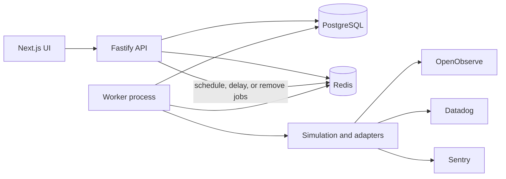
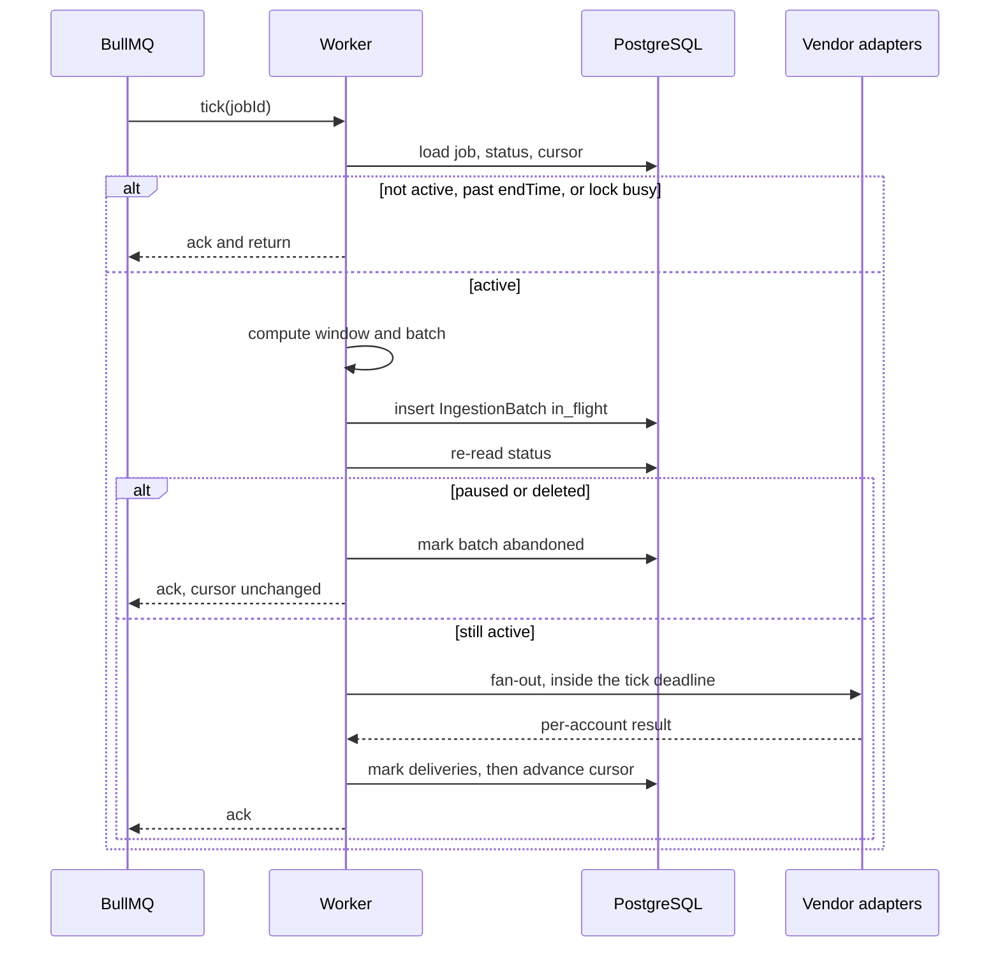
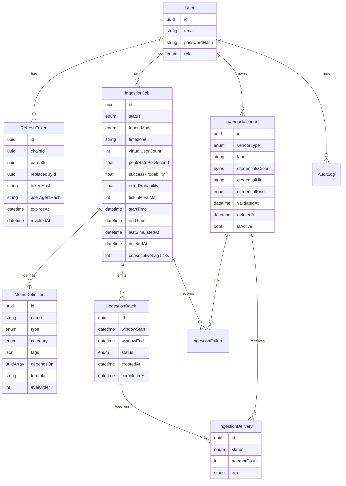

# Metric Ingestion Application — Implementation Plan

The workspace starts empty, so this is a greenfield build. This document is the contract for that build: what ships, which parts of the original prompt change and why, and the exit check for each phase. No application code until a phase is explicitly started.

A review of the first draft is incorporated below. The simulation algebra, the tick lock, scheduled-job pickup, Sentry’s transport, and crash recovery are specified tightly enough to implement. Each review item is indexed at the end.

## What we are building

A multi-user service that keeps vendor credentials encrypted, defines metrics (including formulas over other metrics), and runs a durable simulation whose output looks like daily traffic. A separate worker emits that traffic to one or more OpenObserve, Datadog, and Sentry accounts. The HTTP API never generates telemetry itself.



One tick looks like this:



## Locked decisions

| Topic | Decision | Why |
|---|---|---|
| Layout | pnpm workspaces. `apps/api`, `apps/worker`, `apps/web`. `packages/db`, `packages/core`, `packages/queue`, `packages/contracts`. | The API and the worker must restart independently. Shared Zod schemas live in `contracts`. |
| ORM / HTTP | Prisma and Fastify. | Matches the prompt. Fastify gives validation, rate limit, and OpenAPI. |
| Passwords | Argon2id. Access JWT 15 minutes in `Authorization: Bearer`. Refresh token 7 days, rotated, stored only as a SHA-256 hash, httpOnly `SameSite=Lax` cookie. | A reused refresh token revokes its whole chain. |
| Email verification | Omitted in v1. | There is no mailer. |
| Pause | Pausing removes that job’s repeatable BullMQ job and any delayed starter. Resuming adds the right one back. The worker also re-reads status after the batch is built and before any send. | `queue.pause()` freezes every tenant. Removing the repeatable does not cancel a tick that has already started sending. |
| Downtime and pause gaps | The cursor jumps forward. Missed time is not replayed. | Replaying a gap is the burst the simulation exists to avoid. |
| Delivery record | One `IngestionBatch` row in PostgreSQL, plus one `IngestionDelivery` per account, written before any vendor call. | Redis is not a durable record of an in-flight send. |
| Crash policy | On startup, `in_flight` batches older than `2 × tickIntervalMs` are marked `abandoned` and the cursor is moved to that batch’s `windowEnd` if it is behind. The window is not resent. | The vendor may already have accepted the request. Replaying it duplicates a tick. Dropping one window matches the no-backfill rule. |
| Virtual users | `virtualUserCount` scales the volatility of the slow multiplier `m(t)`. It does not change the mean rate, and it is not a set of session objects. | A per-user state machine every tick will not run on one Node process. With the peak rate held fixed, user count also does not change Poisson variance. See Simulation. |
| Diurnal curve | Periodic Gaussian centered at 14:00 local, floor 0.15, normalized to peak at 1. Weekend factor 0.45, with a 2-hour linear ramp across Friday night and Sunday night. | A single Gaussian steps at midnight. A hard weekend switch steps at Saturday 00:00. The prompt’s `sin²` formula peaks at noon and at midnight. |
| Custom formulas | Arithmetic DSL parsed on save: numbers, metric names, `+ - * /`, parentheses, `random()`, `normal(mean, sd)`. | Invalid formulas fail at save time. |
| Metric ownership | Definitions belong to one job and are deleted with it. `evalOrder` is an integer column written at save. | Dependencies are a per-job graph. |
| Fan-out | `replicate` only. The column exists so `split` can be added later. | Comparing vendors requires the same series on each account. |
| Sentry ingest | DSN envelope to `/api/{projectId}/envelope/` with one `trace_metric` item, per the Sentry metrics spec 2.x (current as of 2026). Types `counter`, `gauge`, `distribution`. Statsd envelopes are the superseded 1.0 format and are not sent. OTLP metrics are not a Sentry endpoint. | Spec 2.0 (2025-11-13) replaced statsd. Sentry’s own OTLP docs say metrics are unsupported. |
| Sentry credentials | DSN and an org auth token are both required. The token is used only for `validateCredentials`. The DSN public key is used only for ingest. | A DSN cannot be checked without sending data. The token can, via the management API. |
| Histogram v1 | Counters and gauges are exact. Histograms are one observation per event. Sentry maps them to `distribution`. Datadog uses its distribution intake where the fixture confirms it, and gauge samples otherwise. | Building sketches inside the simulator is a separate product. |
| Tick size | `tickIntervalMs` is an integer from 1000 to 30000, default 1000. Every window is exactly that long. | A hardcoded 1-second Δ would mis-scale every other interval. |
| Tick budget | Deadline is `0.8 × tickIntervalMs`, and also at least 1 second under the lock TTL. Chunk HTTP timeout is `min(10s, time remaining)`. At most 5 attempts, and only while the deadline has room for the next backoff. | Unbounded retries hold the lock and stall the cursor. |
| Scheduled start | A BullMQ delayed one-shot, id `start:{jobId}`, fires at `startTime` and installs the repeatable. | A `scheduled` row with no delayed job never starts. |
| Internal metrics | `prom-client`. API serves `/metrics` on `PORT` (default 3000). The worker serves `/metrics` and `/health` on `WORKER_METRICS_PORT` (default 3001). | Two processes cannot share one listener. Simulator output is never scraped back into a job. |
| Vendor checks | `validateCredentials` runs on create and on every credential replacement. A failed check returns 422 and does not write the new secret. | A job against a bad key otherwise 401s forever, and those 401s are not retried. |

## Data model



`IngestionJob.status` is `scheduled | active | paused | completed | failed`. `scheduled` is a future `startTime`. `fanoutMode` is `replicate` in v1.

`MetricDefinition.evalOrder` is a dense integer assigned when the job’s definitions are saved. A metric’s order is greater than the order of every metric it depends on. The worker evaluates in that order and does not sort again.

`IngestionBatch.status` is `in_flight | completed | abandoned`. `IngestionDelivery.status` is `pending | delivered | dead`. `IngestionBatch.id` is the idempotency key sent to vendors that accept one. `IngestionFailure` keeps the dead-letter payload (metric points only, never credentials) for 7 days. A daily delete drops failures and `dead` deliveries older than that. Replay (`POST /api/v1/jobs/:id/dlq/:deliveryId/retry`) is out of scope for v1. Job detail returns the last 20 failures.

Vendor ciphertext layout is fixed: 12-byte IV, then 16-byte GCM auth tag, then ciphertext. The API never selects that column for a response.

Job-level fields own the traffic process. A metric may override success and error probabilities. Dependent metrics ignore probabilities and use `formula`.

`dependsOn` may name only metrics on the same job. Save rejects a cycle.

### Credential hints

The hint is derived once at write time and stored. Responses never re-read the cipher to build it.

| Vendor | `credentialKind` | `credentialHint` |
|---|---|---|
| Datadog | `api_key` | Last 4 characters of the API key. |
| OpenObserve, token | `token` | Last 4 characters of the ingestion token. |
| OpenObserve, email + password | `email` | Last 4 characters of the email. The password is never hinted. |
| Sentry | `dsn_key` | Last 4 characters of the DSN public key. The full DSN and the org token are never hinted. |

### Deleting a vendor account

Delete is a soft delete: set `deletedAt`, overwrite `credentialsCipher` with a zero-length value, keep `label`, `vendorType`, and `credentialHint`. It is rejected with 409 when any `scheduled`, `active`, or `paused` job still references the account. `completed` and `failed` jobs keep the foreign key.

### Deleting a job

Delete is a soft delete: set `deletedAt`, remove the repeatable and the delayed starter. Batches stay, with the job foreign key intact. List endpoints hide rows with `deletedAt` set. An in-flight send that has already passed the pre-send status check can finish; the pre-send check treats `deletedAt` as “discard the batch, do not send, do not move the cursor.”

### Refresh tokens

A login creates a chain: `chainId` is new, `parentId` is null. Rotation inserts a child with the same `chainId`, `parentId` pointing at the presented token, and sets `replacedById` on the parent. Presenting a token that already has `replacedById` or `revokedAt` set revokes every row with that `chainId`. `userAgentHash` is SHA-256 of the User-Agent, stored for audit, and is not a secret.

Logout is `POST /auth/logout`. It revokes the chain of the cookie it receives.

`POST /auth/refresh` works from the cookie alone, including when the access token is expired. If an `Authorization` header is present, its JWT signature is checked with expiry ignored, and `sub` must equal the refresh token’s user id. A mismatch returns 401 and does not rotate.

### PATCH on a job

Fields omitted from the body stay as they are. When `definitions` is present it **replaces** the full set for that job. When `vendorAccountIds` is present it **replaces** the full set. Either replacement while `status` is `active` returns 409. Name, timezone, `virtualUserCount`, `peakRatePerSecond`, probabilities, `tickIntervalMs`, and `endTime` apply on the next tick and are allowed while active. `tickIntervalMs` edits remove and recreate the repeatable so the schedule matches.

## Simulation

The hot path is a renewal process whose intensity changes slowly. For a tick covering `[t, t + Δ)`:

```
Δ = tickIntervalMs / 1000    seconds
```

`diurnal`, `weekendBlend`, and `m` are evaluated at `t` and held constant across the tick. `lastSimulatedAt` advances by exactly one window: the new value is `windowEnd`, which is `windowStart + tickIntervalMs`. It never advances by a hardcoded 1000 ms.

### Windows

| Situation | Window | Cursor after a terminal batch |
|---|---|---|
| First tick (`lastSimulatedAt` is null) | `[now, now + Δ)` | `now + Δ` |
| Steady | `[lastSimulatedAt, lastSimulatedAt + Δ)` | previous value plus `tickIntervalMs` |
| Lag (`now - lastSimulatedAt > Δ`) | `[now, now + Δ)`, gap discarded | `now + Δ` |

The first tick does not start at `startTime`. Generating `[startTime, now)` would dump the whole lead-in as one burst. Lag records `simulation_lag_seconds = (now - lastSimulatedAt) / 1000` and increments `consecutiveLagTicks`. Any tick that is not lagging resets that counter to 0. Three consecutive ticks with lag greater than 30 seconds set the job to `failed`, remove the repeatable, and write an audit row `job.auto_failed`. One long outage produces one lag tick and then a caught-up cursor, so a deploy does not fail the job.

### Rate

```
h = local hour in [0, 24) in the job timezone

bump(h)    = Σ exp(-(h - 14 + 24k)² / 24.5)    for k in {-1, 0, 1}
diurnal(h) = 0.15 + 0.85 * bump(h) / bump(14)

weekendBlend = 1.00 on weekdays, 0.45 on Saturday and Sunday,
               linear across Friday 23:00–Saturday 01:00
               and Sunday 23:00–Monday 01:00, in local time

λ(t) = peakRatePerSecond * diurnal(h) * weekendBlend(t) * m(t)
```

`bump(14)` normalizes the peak so `diurnal(14) = 1`. The `k = ±1` terms make `diurnal(0)` and `diurnal(24)` the same value, and they remove the step between 23:59 and 00:01.

`peakRatePerSecond` is the peak of the mean rate. It is not multiplied by `virtualUserCount`.

### What the user count actually changes

A superposition of independent Poisson processes is Poisson. Its variance equals its mean. Holding `peakRatePerSecond` fixed, changing `virtualUserCount` does not change that mean and does not change that variance. The earlier “variance shrinks as N grows” claim was wrong for this model, because the mean rate is not `N` times a per-user rate.

`virtualUserCount` has one job: it scales the volatility of the slow multiplier.

```
smoothness = clamp(0.15, 1, 1 / sqrt(virtualUserCount / 1000))
σ_eff      = σ * smoothness
```

`smoothness` is 1 at or below 1,000 users, and it reaches the floor 0.15 near 44,000 users. It appears in the update of `m`, and therefore in `λ`, on every tick.

### The multiplier

`m(t)` is an Ornstein–Uhlenbeck process mean-reverting to 1, discretized with Euler–Maruyama and then clamped. It is a pure function of `(jobId, startTime, windowStart, virtualUserCount)`. Redis may cache the latest value. A Redis flush does not move the chart, because the next tick recomputes from the seed.

```
Δt = 30 seconds
θ  = 1/600 per second          # correlation time 10 minutes
σ  = 0.00866                   # stationary stddev ≈ 0.15 when smoothness = 1
                               # because Var∞ = σ² / (2θ)

m_0 = 1
Z_n ~ Normal(0, 1) from a mulberry32-class generator
      seeded with the first 4 bytes of SHA-256(jobId)

m_{n+1} = clamp(0.5, 2,
            m_n + θ(1 - m_n)Δt + σ_eff * sqrt(Δt) * Z_n)

n = floor((windowStart - startTime) / 30s)
```

`θ × Δt ≈ 0.05`, so the step is stable. The worker advances the recurrence from `m_0` to step `n`. A job that has run for 30 days is about 86,000 steps, which is cheap next to a vendor call. Parameters are constants in `packages/core`, not per-job fields, in v1.

Conditional on `λ(t)`, exponential inter-arrivals would be a Poisson process and would still have variance equal to the mean. The multiplier is what creates slow swells. Larger `virtualUserCount` makes those swells smaller. It does not make the Poisson component “more Poisson.”

### Inter-arrivals

Inside the tick, inter-arrival times are a mixture with mean `1/λ`:

- 85% exponential with rate `λ` (mean `1/λ`, variance `1/λ²`).
- 15% Pareto Type I with shape `α = 2.5` and `xmin = 0.6 / λ`, which also has mean `1/λ`.

Shape 2.5 is deliberate. At `α ≤ 2` the variance is infinite, so a moment test cannot pass and a single draw can swallow a whole tick. At `α = 2.5` the second moment is finite and still heavier than the exponential, so counts are overdispersed. That overdispersion is the mixture’s doing. It is not a consequence of dropping per-user state.

Timestamps are the cumulative sums of those draws, starting at the window start. Arrivals at or after `windowEnd` are dropped. Nothing in the batch shares a timestamp unless two draws sum to the same instant, which the continuous distributions do not do.

### Branching

Each arrival draws `u ~ Uniform(0,1)`:

- `u < successProbability` emits the success metrics.
- `u < successProbability + errorProbability` emits the error metrics.
- otherwise that arrival emits neither.

Dependent metrics run after the tick totals exist, in `evalOrder`, and produce one point at `windowEnd`. `error_rate = errors / (successes + errors)` emits nothing when the denominator is 0.

The simulation RNG and the multiplier RNG are separate streams. The simulation stream is seeded with SHA-256(`jobId || windowStart`) so a rebuilt window is reproducible. Abandoned windows are not rebuilt.

### Payload bound

If a tick would materialize more than 2,000 points, counters with the same name, tags, and 1-second bucket are summed before send. Gauges in that bucket keep the last sample. The summed counter value still equals the number of events. Sends go out in chunks of at most 500 points. Each chunk is awaited.

## Jobs and the queue

Queue name: `ingestion`. One repeatable job per active ingestion job, BullMQ job id `job.id`, every `tickIntervalMs`, `removeOnComplete: 100`, `removeOnFail: 500`.

### Start, pause, resume

| Transition | Effect |
|---|---|
| Create with `startTime <= now` | Status `active`, repeatable added, `lastSimulatedAt` left null. |
| Create with `startTime` in the future | Status `scheduled`. Delayed one-shot `start:{jobId}` at `startTime`. No repeatable yet. |
| Delayed starter fires | If status is still `scheduled`, set `active` and add the repeatable. `lastSimulatedAt` stays null. |
| Pause while `scheduled` | Remove the delayed starter. Status `paused`. |
| Pause while `active` | Remove the repeatable. Status `paused`. |
| Resume while `startTime` is still in the future | Status `scheduled`, delayed starter added again. |
| Resume after `startTime` | Status `active`, repeatable added, cursor left where it is (null if the job never ticked). |
| `endTime` passed at the start of a tick | Status `completed`, repeatable removed, no send. |

### Lock

```
SET tick:{jobId} {owner} NX EX ttlSeconds
ttlSeconds = min(60, max(2, ceil(2 * tickIntervalMs / 1000)))
```

`owner` is a random id for that attempt. With `tickIntervalMs` capped at 30 seconds, the TTL is exactly `2 × tickInterval` and never exceeds 60 seconds. Release is a Lua compare-and-delete so one attempt cannot delete another’s lock. Release runs on success, on failure, and when the deadline fires. If the key is missing or owned by someone else at release time, increment `tick_lock_lost_total`. That counter means a send outlived the TTL. A crashed worker leaves the key to expire; the next tick waits at most `ttlSeconds`.

### Tick body

1. Load the job. If it is missing, deleted, or not `active`, acknowledge and return. If `endTime` has passed, mark `completed`, remove the repeatable, and return.
2. Take the lock. If `SET NX` fails, acknowledge and return.
3. Compute the window from the table above.
4. Build the batch in memory. Insert `IngestionBatch` (`in_flight`) and one `pending` delivery per account.
5. Re-read the job. If it is not `active`, or `deletedAt` is set, mark the batch `abandoned`, release the lock, and return. The cursor stays put.
6. Decrypt each account, send, wipe the plaintext.
7. When every delivery is `delivered` or `dead`, set the batch `completed` and set `lastSimulatedAt = windowEnd`.
8. Release the lock.

A 401 or other non-429 4xx marks that delivery `dead` immediately and writes `IngestionFailure`. Network errors, 429, and 5xx retry with exponential backoff and jitter, up to 5 attempts, and only when the next sleep still fits in the deadline. The tick result is per account.

### Deadline

The deadline is `0.8 × tickIntervalMs` from tick start, and it is also clipped so it ends at least one second before the lock expires. The per-chunk timeout is `min(10 seconds, time left until the deadline)`.

When the deadline fires mid-tick:

- Abort the chunk in flight.
- Mark that delivery and every delivery still `pending` as `dead`, with reason `tick_deadline`, and write failure rows.
- Set the batch `completed` and advance the cursor to `windowEnd`.
- Increment `tick_deadline_exceeded_total`.
- Release the lock.

The window is not retried on the next tick. Accounts that already returned `delivered` stay delivered. This is what stops lag from growing for as long as a vendor hangs.

### Inject

`POST /api/v1/jobs/:id/inject` is limited to 10 requests per minute per job. The body is one point: `{ metricDefinitionId, value, timestamp? }`. `metricDefinitionId` must belong to that job. `value` must be a finite number. `timestamp`, when present, must fall in the last hour and must not be more than 5 seconds in the future. The handler enqueues a one-shot on `ingestion`. That one-shot does not insert an `IngestionBatch`, does not take the tick lock, and does not read or write `lastSimulatedAt`.

### Shutdown

On SIGTERM the worker stops taking new jobs, waits for the in-flight tick until its deadline, releases the lock, and exits 0. If the deadline hits during shutdown, the batch is abandoned the same way as a deadline miss, except the cursor is still advanced so a restart does not rebuild the window.

### Worker startup

Scan `IngestionBatch` where `status = in_flight` and `createdAt` is older than `2 × tickIntervalMs`. Mark each `abandoned`. If the job’s `lastSimulatedAt` is null or older than that batch’s `windowEnd`, set it to `windowEnd`. Also repair rows already `completed` whose `windowEnd` is ahead of the cursor. Young `in_flight` rows are left alone until they age past the threshold, which is how a successor avoids colliding with a tick that is still inside its lock TTL.

## Security and operations

- Boot fails if `ENCRYPTION_KEY` is missing or not 32 bytes, or if JWT secrets are missing.
- In production, boot fails if `CORS_ORIGINS` is empty. `@fastify/cors` allows only that list. Local Compose serves the UI and the API on one origin, so the list can be empty when `NODE_ENV` is not `production`.
- Zod on every body and query. Prisma for every SQL call.
- `@fastify/rate-limit`: 5 requests per minute per IP on auth routes, 100 requests per minute per user on `/api/v1/*`, plus the inject limit above.
- Password length at least 12, and the candidate must not appear in `data/password-denylist.txt`. That file is the SecLists `10-million-password-list-top-100000.txt` (100,000 lines), committed in the repo, with the source URL and the line count recorded in the README.
- Pino redacts `authorization`, `password`, `credentials`, `apiKey`, `appKey`, `dsn`, and `token`.
- Audit rows for signup, login, credential create, update, delete, job create, pause, resume, delete, inject, and auto-fail. Metadata never contains secrets.
- Worker logs include `jobId`, `batchId`, and `vendorAccountId`.
- Container entrypoint runs `prisma migrate deploy` before the API listens. Local equivalent is `pnpm db:migrate`.

Outbound limits are Redis token buckets per account. Defaults: Datadog 300 requests per minute, OpenObserve 60 per second, Sentry 20 per second, overridable per account. An empty bucket delays the chunk until the deadline. If the delay does not fit, the delivery goes `dead` with reason `rate_limited` and the cursor still advances. It does not spin into the next tick.

## HTTP surface

Public: `POST /auth/signup`, `POST /auth/login`, `POST /auth/refresh`, `POST /auth/logout`.

Authenticated list routes take `limit` (default 50, max 100) and an opaque `cursor` of `(createdAt, id)`.

| Method | Path | Behavior |
|---|---|---|
| POST | `/api/v1/vendor-accounts` | Validate, then encrypt and store. 422 on a failed check, nothing stored. |
| GET | `/api/v1/vendor-accounts` | Hints, `credentialKind`, `validatedAt`, `isActive`. No ciphertext. |
| PATCH | `/api/v1/vendor-accounts/:id` | Label and `isActive` without a re-check. A new credential blob is validated first; failure leaves the old cipher in place. |
| DELETE | `/api/v1/vendor-accounts/:id` | Soft delete. 409 if a non-terminal job references it. |
| POST | `/api/v1/vendor-accounts/:id/validate` | Run the check again and refresh `validatedAt`. |
| POST | `/api/v1/jobs` | Create definitions, validate the DAG, write `evalOrder`. `startTime <= now` installs the repeatable. A future `startTime` inserts the delayed starter and sets `scheduled`. |
| GET | `/api/v1/jobs`, `GET /jobs/:id` | Owner-scoped. Detail includes definitions in `evalOrder`, the cursor, and the last 20 failures. |
| PATCH | `/api/v1/jobs/:id` | See the PATCH rules above. |
| POST | `/api/v1/jobs/:id/pause`, `/resume` | Remove or restore the repeatable or the delayed starter. |
| DELETE | `/api/v1/jobs/:id` | Soft delete and remove queue jobs. |
| POST | `/api/v1/jobs/:id/inject` | One point. Does not move the cursor. |

OpenAPI is generated from the Fastify schemas at `/docs`.

### Credential blobs and checks

Exact bodies are fixture-tested in Phase 2. The transport is fixed now.

- OpenObserve: `baseUrl`, `organization`, and either `email` + `password` or an ingestion token. Check: authenticated `GET {baseUrl}/api/{organization}/`, expecting 200. Ingest: `POST {baseUrl}/api/{organization}/ingest/metrics/_json`.
- Datadog: `apiKey`, `appKey`, `site`. Check: `GET https://api.{site}/api/v1/validate` with `DD-API-KEY`. Ingest: `POST https://api.{site}/api/v2/series` for counters and gauges. The app key is stored for a later read API and is not sent on the series call.
- Sentry: `dsn`, `orgAuthToken`. Check: `GET /api/0/projects/{org}/{project}/` with `Authorization: Bearer {orgAuthToken}`, org and project parsed from the DSN. Ingest: `POST {dsnBase}/api/{projectId}/envelope/` with `X-Sentry-Auth: Sentry sentry_version=7, sentry_key={publicKey}, sentry_client=fireweave-metric-injector/0.1`. The body is one envelope item:

```json
{
  "type": "trace_metric",
  "item_count": 1,
  "content_type": "application/vnd.sentry.items.trace-metric+json"
}
```

followed by `{ "version": 2, "items": [ ... ] }`. Each item has `timestamp` (Unix seconds), `trace_id` (32 hex chars, random per batch, not a real trace), `name`, `type` (`counter` | `gauge` | `distribution`), `value`, and `attributes` as typed `{ value, type: "string" }` pairs. `span_id` is omitted. These points show up as Sentry metrics. They are not attached to an application transaction. Mapping from our types: `counter → counter`, `gauge → gauge`, `histogram → distribution`.

## Phases

Each phase ends when its checks pass. Commits happen when explicitly requested.

**Phase 1 — Foundation.** pnpm workspace, strict TypeScript, ESLint, Prettier, Docker Compose for Postgres and Redis, Prisma schema for users, refresh tokens, and the rest of the tables that later phases fill, `prisma migrate deploy` in the API container entrypoint, Fastify health check, signup/login/refresh/logout, auth guard, auth rate limit, password denylist file. Checks: a request without a token gets 401 on `/api/v1/jobs`; rotating a refresh token and presenting the old one revokes the chain; refresh with a mismatched `sub` returns 401; `password` and `123456` are rejected; a 12-character password that is not on the list is accepted.

**Phase 2 — Vendors.** Account CRUD, AES-256-GCM helper, three adapters, pagination on the account list. HTTP is injected so unit tests never touch the network. Checks: known-answer encrypt/decrypt, flipping one ciphertext byte fails authentication, stored bytes are `iv(12) || authTag(16) || ciphertext`. One DTO test per adapter: the serialized account contains no substring of the API key, app key, password, token, full DSN, or org token. Hint tests match the table above. Create with a failing check stores nothing. Replacing credentials with a failing check keeps the previous cipher. Delete is rejected when a paused job references the account, and allowed when only a completed job does. The Sentry fixture is a `trace_metric` envelope, including `item_count` and the content type. A statsd item fails the test.

**Phase 3 — Metrics.** Definition CRUD inside a job, tag validation, DSL parser, cycle detection, `evalOrder`. Checks: the cycle `a → b → a` is rejected; `errors / (successes + errors)` evaluates with a fixture context; saved `evalOrder` puts dependencies after their inputs.

**Phase 4 — Simulation, no I/O.** Pure functions in `packages/core`. Checks, all with a fixed seed:

- `diurnal(14)` is 1, and a 03:00 value is near the floor and below the 14:00 value.
- `diurnal(0) = diurnal(24)`, and the gap between 23.99 and 0.01 is under 0.01.
- Friday 22:00 weekend factor is 1, Saturday 02:00 is 0.45, Friday 23:30 is 0.725.
- Sample variance of `m` over a fixed horizon is smaller at `virtualUserCount = 100000` than at `1000`, with the same `jobId` and `startTime`. `λ` changes with it.
- Kolmogorov–Smirnov test on exponential-only draws, and a separate one on Pareto-only draws.
- The mixture’s sample mean matches `1/λ`. Its sample variance exceeds the exponential variance. Per-second counts are overdispersed (sample variance greater than the sample mean).
- The same seed and the same clock produce the same points.
- Success and error counts match the configured probabilities within sampling error.
- A tick whose raw size exceeds 2,000 points is bucketed, and counter totals are preserved.
- `Δ` follows `tickIntervalMs`: a 5-second tick emits a window 5 seconds long, and the cursor math adds 5000 ms.

**Phase 5 — Job lifecycle.** Worker process, repeatable ticks, delayed starter, lock, deadline, batches, pause/resume, inject, retries, dead letter, startup repair, graceful shutdown. Vendor HTTP is a fake adapter. Checks against Compose Postgres and Redis:

- Create, a tick advances `lastSimulatedAt` by `tickIntervalMs`, pause stops new sends, resume does not backfill, delete removes the repeatable.
- A job created with `startTime` two seconds ahead stays `scheduled` with no repeatable, then becomes `active` and ticks.
- The first tick’s window starts at `now`, not at `startTime`.
- Pause that lands after the batch insert and before send leaves the batch `abandoned` and the cursor unchanged.
- Killing the worker after the batch insert and before the cursor update, then starting again, leaves a single cursor value and an `abandoned` or `completed` batch. It does not insert a second batch for that window.
- One account of three returns 401. The cursor advances, one delivery is `dead`, two are `delivered`.
- Inject shows up in the fake vendor’s received list and leaves `lastSimulatedAt` unchanged.
- A hung vendor trips the deadline: the chunk is dead-lettered, the cursor advances, `tick_deadline_exceeded_total` increments.
- SIGTERM during a tick releases the lock.
- Three ticks in a row with lag above 30 seconds mark the job `failed` and remove the repeatable.
- PATCH with a one-element `definitions` array deletes the other definitions. The same PATCH while `active` returns 409.
- `GET /jobs` honors `limit` and `cursor`.

**Phase 6 — Hardening.** User rate limit, outbound token buckets, Pino redaction, CORS allow-list, Prometheus series on the two ports (`ingestion_jobs_active`, `metrics_sent_total`, `vendor_errors_total`, `simulation_tick_duration_ms`, `simulation_lag_seconds`, `tick_deadline_exceeded_total`, `tick_lock_lost_total`), audit writes. Checks: a 429 is retried and a 401 is not; a failed ingest log contains no credential fields; the worker’s `/metrics` answers on `WORKER_METRICS_PORT` and the API process does not serve it.

**Phase 7 — Web.** Next.js App Router, Tailwind, shadcn/ui. Screens: signup, login, vendor accounts (hint, kind, `validatedAt`), job list, job detail (pause, resume, delete, inject, last failures), metric editor. No DLQ browser. This phase starts only after the UI is explicitly requested. Compose serves one origin locally. Production uses `CORS_ORIGINS`.

**Phase 8 — Docs and the full test pass.** README covers env vars, `prisma migrate deploy`, both processes, the rate formula, the no-backfill rule, the Sentry `trace_metric` transport, and the 7-day failure retention. OpenAPI is published from the app. One integration test walks the lifecycle. `pnpm test:vendor-sandbox` hits real vendor projects and is documented as manual, gated by env vars, and not part of CI. Testcontainers stays optional behind an env flag. Compose is the default local dependency.

## Out of scope for v1

Email verification, admin screens, the `split` fan-out mode, pre-aggregated histogram sketches, multi-host worker sharding, a DLQ replay endpoint, Sentry OTLP metrics, the superseded Sentry statsd envelope, and a Temporal migration. BullMQ plus per-job repeatables and one delayed starter covers pause, resume, delay, and crash recovery for this workload. Temporal becomes worth it only if a tick grows into a multi-step workflow that must compensate across vendors.

## Local shape when implementation starts

`ENCRYPTION_KEY`, `JWT_ACCESS_SECRET`, `JWT_REFRESH_SECRET`, `DATABASE_URL`, and `REDIS_URL` are required. `CORS_ORIGINS` is required when `NODE_ENV=production`. `WORKER_METRICS_PORT` defaults to 3001.

`docker compose up` runs Postgres and Redis. The API container migrates, then listens. Two processes: `pnpm --filter api dev` and `pnpm --filter worker dev`.

Phase 1 is the right place to start.

## Review resolutions

| Id | Resolution |
|---|---|
| C1 | `smoothness` multiplies `σ` in the Euler–Maruyama update. Phase 4 compares `m`’s variance at 1,000 and at 100,000 users. |
| C2 | The Poisson-superposition paragraph now says variance equals the mean when the peak rate is held fixed. Clusters come from the Pareto mixture. User count only scales multiplier volatility. |
| C3 | `Δ = tickIntervalMs / 1000`. The cursor moves by `tickIntervalMs`. Allowed range is 1–30 seconds. |
| C4 | `SET key owner NX EX ttl` with TTL = `2 × tickInterval`, capped at 60 seconds. Compare-and-delete release on every path. `tick_lock_lost_total` counts a lost owner. |
| C5 | Delayed one-shot `start:{jobId}` promotes `scheduled` to `active`. Covered by a Phase 5 check. |
| C6 | Ingest is a `trace_metric` envelope per Sentry metrics spec 2.x. Statsd is superseded. OTLP metrics are unsupported and out of scope. Both the DSN and an org token are required. |
| C7 | Tick deadline `0.8 × tickIntervalMs`, chunk timeout 10 seconds, both inside the lock TTL. Deadline dead-letters the rest of the fan-out and advances the cursor. Phase 5, not Phase 6. |
| M1 | `IngestionBatch` and `IngestionDelivery` live in PostgreSQL. Startup marks stale `in_flight` rows `abandoned` and repairs the cursor. No resend. |
| M2 | Status is re-read after the batch insert and before send. A pause in that window abandons the batch and leaves the cursor. A send already on the wire can finish. Phase 5 test. |
| M3 | `evalOrder` is a column on `MetricDefinition` and is in the ER diagram. |
| M4 | Hint rules are per vendor in the table above, with a DTO leak test per adapter. |
| M5 | Delete is rejected for `scheduled`, `active`, and `paused` jobs. Terminal jobs keep the foreign key. The account is soft-deleted and the cipher is wiped. |
| M6 | Validation is required on create and on credential replacement. `validatedAt` is on the DTO. |
| M7 | Periodic Gaussian over `k ∈ {-1,0,1}`, plus a 2-hour weekend ramp. Phase 4 checks both. |
| M8 | The chi-square-against-exponential check is gone. Phase 4 uses fixed-seed KS tests per component, a moment check, and an overdispersion check. Pareto shape is 2.5 so the variance exists. |
| M9 | The first window is `[now, now + Δ)`. |
| Migrations | `prisma migrate deploy` runs before the API listens. |
| Shutdown | SIGTERM drains the current tick up to the deadline, then releases the lock. |
| CORS | Allow-list in Phase 6, required in production. |
| CSRF | Logout is POST. Refresh rejects a present access token whose `sub` does not match. |
| Inject | 10 per minute per job, one finite value, definition must belong to the job, timestamp bounded. |
| Lag | More than 30 seconds on 3 consecutive ticks fails the job and removes the repeatable. |
| DLQ | Rows older than 7 days are deleted. Replay is named and left out of v1. |
| OU | `θ = 1/600`, `σ = 0.00866`, `Δt = 30s`, clamp `[0.5, 2]`, Euler–Maruyama. |
| Redis loss | `m(t)` is recomputed from `jobId` and `startTime`. |
| Crypto tests | Known answer, tamper, and the byte layout, in Phase 2. |
| Metrics port | Worker uses `WORKER_METRICS_PORT`. |
| Pagination | `limit` and `cursor` on both list endpoints. |
| Delete vs in-flight | Soft delete. Pre-send re-read discards. A send already started can finish. Batches keep their job foreign key. |
| Password list | SecLists top 100,000, committed, pinned in the README. |
| PATCH | Omitted fields stay. `definitions` and `vendorAccountIds`, when present, replace the whole set. Structural replace while `active` is 409. |
| Refresh schema | `chainId`, `parentId`, `replacedById`, `revokedAt`, `expiresAt`, `userAgentHash` are on `RefreshToken`. |
